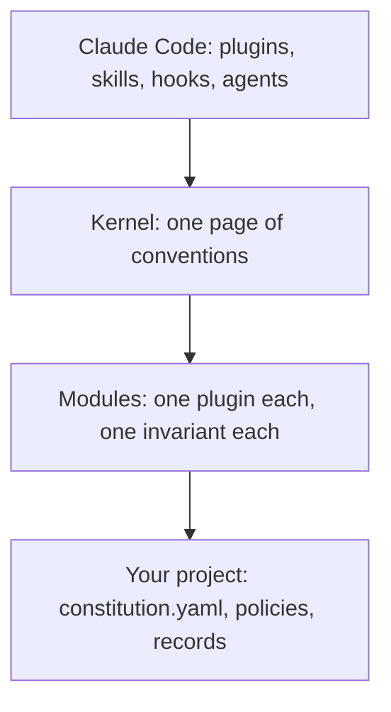

# Constitution Kit

A portable governance layer for Claude Code projects, shipped as plugins.

AI sessions write documents, make decisions and change code fast. Without shared rules, every session improvises: documents with no stated authority, decisions lost in chat, a typo and a security ruling priced the same, documents that drift from the code with no owner. The kit installs those rules into any repository, new or existing: a one-page semantic kernel, and modules that guard it, each a Claude Code plugin calibrated by one `constitution.yaml`. The [intent page](INTENT.md) says what the kit is for and what it is not.

## Why it is shaped this way

A heavyweight constitution costs more than the disorder it cures: fixed ceremony for every question, hundreds of rules before the first product decision. The kit takes the middle road ([intent §2](INTENT.md#i2)):

- **A minimal core.** One page of vocabulary — the document envelope, three meta-types, governance by territory, stakes, the decision record, dials — and nothing git already records ([the kernel](kernel/CONVENTIONS.md)).
- **Hard gates only where a check is deterministic.** Everything that needs judgment is advisory and says so ([principle p4](INTENT.md#p4)).
- **Ceremony scales with stakes.** A routine call is a line in the commit; a `process` ruling is a record and one human yes ([principle p3](INTENT.md#p3)).
- **Growth only from friction.** A module is added when a failure recurs in real projects, never for a failure nobody has hit ([principle p2](INTENT.md#p2)).

## How it works



1. **Claude Code is the mechanical layer.** The kit never wraps or mirrors the platform's plugins, skills, hooks and agents ([intent §3](INTENT.md#i3)).
2. **The kernel is the semantic layer.** A project copies it into `docs/constitution/`, and it is the first document its own rules govern.
3. **Each module is one plugin.** It guards one invariant, depends on the kernel and nothing else, and reads only its own namespace of the project's `constitution.yaml`. It works on an empty repository with its defaults alone.
4. **The project holds the binding.** Its policies, territories, thresholds, deciders and every governed document are its own; the kit ships none of them.

## The modules

Every gate's error message says what failed, why the rule exists, and the exact fix. A gate is deterministic, and red means fix; a skill shapes judgment and checks nothing. The Module column links each module's own page, which says in plain language what it gives you, why, how a session behaves with it, how it works and how to get it.

| No. | Module | What it holds | Gate | Advisory |
|---|---|---|---|---|
| 1 | [`const-meta-types`](modules/const-meta-types/README.md) | every document in claimed territory carries the envelope and has exactly one governing policy | at write time and in a scan | choosing a meta-type |
| 2 | [`const-decision-records`](modules/const-decision-records/README.md) | a decision record carries its type, stakes and decider | at write time and in a scan | pricing and recording a decision |
| 3 | [`const-catalogs`](modules/const-catalogs/README.md) | a numbered document's file name, id and number agree, and no number repeats | at write time and in a scan | taking a number, renumbering |
| 4 | [`const-locations`](modules/const-locations/README.md) | a document is born in its canonical home, from its kind's template | none | creating documents, introducing a kind |
| 5 | [`const-referencing`](modules/const-referencing/README.md) | references a machine can follow and a move can repair | at write time and in a scan | citing, anchoring, moving |
| 6 | [`const-task-close`](modules/const-task-close/README.md) | a change to described code updates its documents or declares no impact | a range check; a dirty tree at turn end | closing a task, committing |
| 7 | [`const-questions`](modules/const-questions/README.md) | no open question inside a delivered document | at write time and in a scan | when to ask, and the shape of a question |
| 8 | [`const-interaction`](modules/const-interaction/README.md) | a prompt before a listed destructive command; every list item addressable | a shell hook and a scan | the shape of every reply |
| 9 | [`const-styling`](modules/const-styling/README.md) | one style guide, a departure declared with its reason | a scan | the style defaults |
| 10 | [`const-language`](modules/const-language/README.md) | plain prose under a grade ceiling and a sentence limit | after every write and in a scan | writing plain English |
| 11 | [`const-doc-budgets`](modules/const-doc-budgets/README.md) | a character ceiling per group of documents, set from history | after every write and in a scan | setting a ceiling |

## What a gate says

A write that cites a document by its id in backticks, where a link is required, is refused with this message, from [`const-referencing`](docs/requirements.md#const-referencing):

```text
RED: INSTALL.md:50: document id 'constitution-kernel' stands in backticks and is no link
  why: an id names a document that can move: only a link lets a reader reach it and lets a move repair it
  fix: write [constitution-kernel](kernel/CONVENTIONS.md) — the path from this document to kernel/CONVENTIONS.md
```

The session reads the fix, makes it, and writes again; nobody has to explain the rule.

## Status

The modules ship as drafts, each at version `0.0.x` until Phase D of the [rollout plan](docs/rollout-plan.md#phase-d) publishes it. The kit is its own first consumer: its own documents, code territories and session conduct run under its modules. No other project has adopted it yet, so the first one's bootstrap is each module's consumer-live proof. CI runs every gate, each module's install on a bare repository, and the install guide's own commands, on every pull request.

## Get started

The [install guide](INSTALL.md) bootstraps a new project step by step: the prerequisites, the modules loaded first, the kernel copied, the first policies, the dials file and the first record, then a scan of every module. It also covers installing one module, updating and uninstalling. CI runs its commands on every change to the kit.

## Repository map

| No. | Path | What it holds |
|---|---|---|
| 1 | `kernel/` | the semantic kernel, `CONVENTIONS.md`, and its schemas |
| 2 | `modules/` | the modules, one plugin each, each with a `README.md` that is its landing page |
| 3 | `module-template/` | the fixed shape every module fills |
| 4 | `shared/` | the code every gate shares, a Python package that each module imports and pip installs ([shared/GATE.md](shared/GATE.md)) |
| 5 | `docs/` | the requirements matrix, the rollout plan, the kit's policies, decision records, research and style guide |
| 6 | `templates/` | the templates of the kit's own document kinds |
| 7 | `scripts/` | the kit's own checks and hooks, never shipped in a module |

## License

The kit is under the [Apache License 2.0](LICENSE). You may use it, change it and sell what you build with it. Keep the credit in [NOTICE](NOTICE) with every copy you pass on.

## Where to go next

- **To adopt the kit:** the [install guide](INSTALL.md).
- **To understand it:** the [intent page](INTENT.md), then the [kernel](kernel/CONVENTIONS.md).
- **To build or change a module:** the session guide, [CLAUDE.md](CLAUDE.md), and the [module template](module-template/MODULE.md).
- **To see why a rule exists:** the decision records in `docs/decisions/`, each with its options, its reasoning and who decided.
